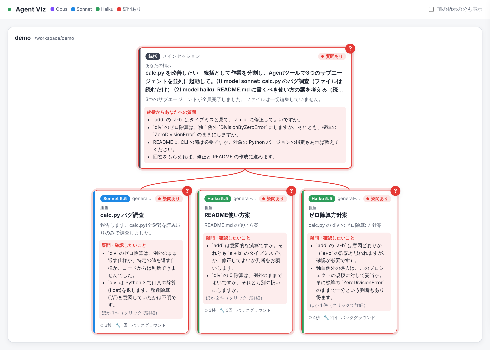

# agent-viz

Claude Code の統括（メインセッション）とサブエージェントの関係をブラウザで図にして表示する、Claude Code プラグインです。

- 統括カード: あなたの指示、今やっていること、統括からあなたへの質問
- サブエージェントのカード: 担当、モデル（色分け）、作業中・完了・疑問ありの状態、経過時間、ツールの使用回数
- 子が報告の中で疑問を書くと、カードが赤く光り「?」が付く
- カードをクリックすると、依頼内容の全文、最終報告、作業ログを見られる
- worktree などで複数のセッションを同時に動かすと、セッションごとにボードが並ぶ

| 作業中 | 完了後（疑問あり） |
|---|---|
|  |  |

## 必要なもの

- Node.js 18 以上（Claude Code が動いている環境なら、ほぼ入っています）
- npm パッケージへの依存はありません

## インストール

### A. まず試す（インストールしない）

```bash
claude --plugin-dir /path/to/agent-viz
```

最初のイベントが届いた時点でサーバーが自動で起動します。ブラウザで http://localhost:4777 を開いてください。

### B. GitHub に置いて普通にインストールする（おすすめ）

このフォルダを GitHub のリポジトリ（例: `snrnapa/agent-viz`）として push し、Claude Code の中で次を実行します。

```
/plugin marketplace add snrnapa/agent-viz
/plugin install agent-viz@agent-viz
```

### C. devcontainer で自動的に入れる

`devcontainer.json` に次の2つを追加します。

```jsonc
{
  "postCreateCommand": "claude plugin marketplace add snrnapa/agent-viz && claude plugin install agent-viz@agent-viz",
  "forwardPorts": [4777]
}
```

VS Code はポート 4777 を自動で転送するので、ホスト側のブラウザから http://localhost:4777 で見られます。

会社のネットワークから GitHub に届かない場合は、このフォルダをリポジトリ内（例: `tools/agent-viz`）に置いて、`claude plugin marketplace add ./tools/agent-viz` のようにパスを指定します。

## 見た目だけ確認する（Claude を動かさずに）

```bash
node server/server.mjs &      # サーバー起動
node bin/demo.mjs             # 記録済みのイベントを再生（引数で速度倍率、既定 3 倍）
```

## 「担当」と「疑問」をうまく出すコツ

カードの「担当」には、統括がサブエージェントを呼ぶときの `description` が表示されます。「疑問」は、報告の中の `【疑問】`、`## 疑問`、`質問:` のような見出しの下の行から拾います。見出しがない場合は、「？」で終わる行を拾います。

確実に表示させるには、CLAUDE.md かサブエージェントの定義に次のように書いておきます。

```markdown
## サブエージェントへの依頼ルール
- サブエージェントに依頼するときは、description に担当を短く書くこと。
- サブエージェントの報告は、最後を必ず次の見出しで締めさせること。
  【担当】【やったこと】【疑問】（疑問がなければ「なし」）
- 統括も、ユーザーに確認したいことがあれば最後に【疑問】としてまとめること。
```

## 設定（環境変数）

| 変数 | 既定値 | 内容 |
|---|---|---|
| `AGENT_VIZ_PORT` | `4777` | サーバーのポート |
| `AGENT_VIZ_HOST` | `127.0.0.1` | 待ち受けるアドレス。コンテナの外から直接つなぐ場合は `0.0.0.0` |
| `AGENT_VIZ_AUTOSTART` | `1` | `0` にすると、hook がサーバーを自動起動しない |
| `AGENT_VIZ_DISABLE` | なし | `1` にすると、イベントを送らない |
| `AGENT_VIZ_RECORD` | なし | ファイルパスを指定すると、受け取ったイベントを jsonl で記録する（デバッグ用） |

## 仕組み

```
Claude Code ──hook──▶ bin/hook.mjs ──HTTP POST──▶ server/server.mjs ──SSE──▶ ブラウザ
```

- hook は `SessionStart`、`UserPromptSubmit`、`PreToolUse`、`PostToolUse`、`SubagentStart`、`SubagentStop`、`Stop`、`Notification`、`SessionEnd` で動きます。
- hook はどんなエラーが起きても何も出力せず exit 0 で終わるので、Claude Code の動作は止まりません。サーバーへの送信は 0.8 秒でタイムアウトします。
- ファイルの中身やコマンドの出力は送りません。送るのは、ツール名、短い要約、依頼文、最終報告だけです。
- サーバーはメモリ上にだけ状態を持ち、12 時間動きのないセッションは消えます。ログは `/tmp/agent-viz-4777.log` に出ます。
- サーバーを止めるには `pkill -f agent-viz/server/server.mjs` を実行します。

## 既知の制限

- 統括自身のモデル名は hook に渡されないため、表示しません。
- Agent Teams（実験機能）のチームメイト同士のメッセージには、まだ対応していません。
- ツール呼び出しのたびに node を 1 回起動します（数十ミリ秒）。気になる場合は `hooks/hooks.json` の `PreToolUse` と `PostToolUse` を消すと、担当と報告だけの表示になります。

## ライセンス

MIT
