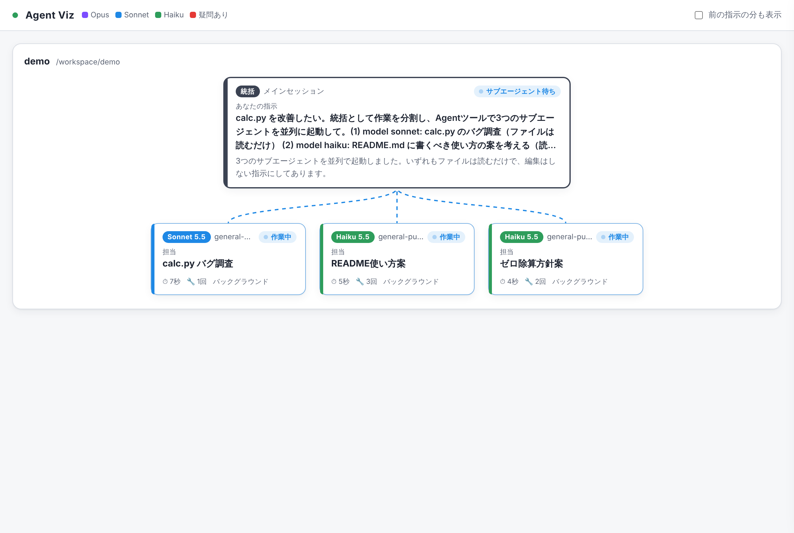

# agent-viz

Claude Code の統括（メインセッション）とサブエージェントの関係をブラウザで図にして表示する、Claude Code プラグインです。

- 統括カード: あなたの指示、今やっていること、統括からあなたへの質問
- サブエージェントのカード: 担当、モデル（色分け）、作業中・完了・疑問ありの状態、経過時間、ツールの使用回数
- 子が報告の中で疑問を書くと、カードが赤く光り「?」が付く
- カードをクリックすると、依頼内容の全文、最終報告、作業ログを見られる
- worktree などで複数のセッションを同時に動かすと、セッションごとにボードが並ぶ
- 盤面から答えられる（許可・質問・次の指示）。端末に戻らずに答えられます。詳しくは「盤面から答える」へ

| 作業中 | 完了後（疑問あり） |
|---|---|
|  |  |

## 必要なもの

- Node.js 18 以上（Claude Code が動いている環境なら、ほぼ入っています）
- npm パッケージへの依存はありません

## インストール

### A. まず試す（インストールしない）

```bash
claude --plugin-dir /path/to/agent-viz
```

最初のイベントが届いた時点でサーバーが自動で起動します。ブラウザで http://localhost:4777 を開いてください。

### B. GitHub に置いて普通にインストールする（おすすめ）

このフォルダを GitHub のリポジトリ（例: `snrnapa/agent-viz`）として push し、Claude Code の中で次を実行します。

```
/plugin marketplace add snrnapa/agent-viz
/plugin install agent-viz@agent-viz
```

### C. devcontainer で自動的に入れる

`devcontainer.json` に次の2つを追加します。

```jsonc
{
  "postCreateCommand": "claude plugin marketplace add snrnapa/agent-viz && claude plugin install agent-viz@agent-viz",
  "forwardPorts": [4777]
}
```

VS Code はポート 4777 を自動で転送するので、ホスト側のブラウザから http://localhost:4777 で見られます。

会社のネットワークから GitHub に届かない場合は、このフォルダをリポジトリ内（例: `tools/agent-viz`）に置いて、`claude plugin marketplace add ./tools/agent-viz` のようにパスを指定します。

## 見た目だけ確認する（Claude を動かさずに）

```bash
node server/server.mjs &      # サーバー起動
node bin/demo.mjs             # 記録済みのイベントを再生（引数で速度倍率、既定 3 倍）
```

## 「担当」と「疑問」をうまく出すコツ

カードの「担当」には、統括がサブエージェントを呼ぶときの `description` が表示されます。「疑問」は、報告の中の `【疑問】`、`## 疑問`、`質問:` のような見出しの下の行から拾います。見出しがない場合は、「？」で終わる行を拾います。

確実に表示させるには、CLAUDE.md かサブエージェントの定義に次のように書いておきます。

```markdown
## サブエージェントへの依頼ルール
- サブエージェントに依頼するときは、description に担当を短く書くこと。
- サブエージェントの報告は、最後を必ず次の見出しで締めさせること。
  【担当】【やったこと】【疑問】（疑問がなければ「なし」）
- 統括も、ユーザーに確認したいことがあれば最後に【疑問】としてまとめること。
```

## 盤面から答える

盤面から、端末に戻らずに次の 3 つへ答えられます。

1. **許可**: 許可ダイアログの「許可」「拒否」。「端末で判断」を選べば、従来どおり端末に出ます
2. **質問**: `AskUserQuestion`（選択式の質問）への回答。選択肢のほか、「その他」の自由入力もできます。全問に答えるまで「送信」は押せません
3. **次の指示**: 統括が止まったときに送る次の指示。セッションのカードの「次の指示を待つ」をオンにしたセッションだけです

### 使い方

- ヘッダーの「盤面で回答する」スイッチが、この機能の全体のオンとオフです。ヘッダーには、今回答できる状態かが表示されます。
- 許可と質問は、そのセッションのカードに出ます。ボタンを押すと、その答えが統括に返ります。
- 次の指示は、「次の指示を待つ」をオンにしたセッションのカードに、テキストエリアが出ます。送ったテキストが、統括の次の指示になります。「待機をやめる」を押すと、待たずに端末に戻ります。
- 待機モードは、統括が止まるたびに最大 10 分待ちます。セッションごとのスイッチなので、ほかのセッションには影響しません。
- 残り時間がカードに出ます。時間が過ぎると、待つのをやめて端末に戻ります。

### 盤面が見えているときだけ待つ

盤面のタブが見えている（前面に表示されている）間だけ、盤面の回答を待ちます。タブを閉じたり、ほかのウィンドウの陰に隠したりすると、待たずに従来どおり端末に出ます。盤面に出ていないセッションも待ちません。

盤面は 10 秒ごとに「見えている」ことを知らせ、25 秒届かないと「見えていない」と判断します。

### 端末でも答えられる

同じ許可や質問には、端末でも答えられます。先に答えたほうが有効になり、もう一方は取り下げられます。盤面で先に答えれば盤面の答えが使われ、端末で先に答えれば端末の答えが使われます。盤面で答えた後に端末で答えると、盤面のボタンは「端末か別のタブで回答済みです」と表示されます。

### 時間切れ

盤面の回答を待つ時間には上限があります（既定は、許可 120 秒、質問 300 秒、次の指示 600 秒）。時間が過ぎると、端末の従来のダイアログや入力に戻ります。待ち時間は環境変数で変えられます（後述の設定）。

## 設定（環境変数）

| 変数 | 既定値 | 内容 |
|---|---|---|
| `AGENT_VIZ_PORT` | `4777` | サーバーのポート |
| `AGENT_VIZ_HOST` | `127.0.0.1` | 待ち受けるアドレス。コンテナの外から直接つなぐ場合は `0.0.0.0`（「セキュリティ」の節を参照） |
| `AGENT_VIZ_ALLOWED_HOSTS` | なし | 盤面を開くときに使ってよい Host を追加する（カンマ区切り。例 `myhost:4777`）。`AGENT_VIZ_HOST` に具体的なホスト名や IP を指定したときは、その `HOST:PORT` が自動で加わります |
| `AGENT_VIZ_STRICT_KEY` | なし | `1` にすると、画面にトークンを渡すのは `?key=` が一致したときだけになります（localhost から開いても渡しません） |
| `AGENT_VIZ_TRUST_LOOPBACK` | なし | `1` にすると、接続元のユーザーを確かめられない環境（Linux 以外、例 macOS）で、localhost から開いた画面にもトークンを渡します。1 人だけが使うマシンでだけ使ってください |
| `AGENT_VIZ_WAIT_PERMISSION_SEC` | `120` | 許可の確認で、盤面の回答を待つ秒数 |
| `AGENT_VIZ_WAIT_QUESTION_SEC` | `300` | 質問への回答を、盤面で待つ秒数 |
| `AGENT_VIZ_WAIT_FOLLOWUP_SEC` | `600` | 次の指示を、盤面で待つ秒数（待機モード） |
| `AGENT_VIZ_AUTOSTART` | `1` | `0` にすると、hook がサーバーを自動起動しない |
| `AGENT_VIZ_DISABLE` | なし | `1` にすると、イベントを送らない |
| `AGENT_VIZ_RECORD` | なし | ファイルパスを指定すると、受け取ったイベントを jsonl で記録する（デバッグ用） |

## 仕組み

```
Claude Code ──hook──▶ bin/hook.mjs ──HTTP POST──▶ server/server.mjs ──SSE──▶ ブラウザ
Claude Code ──hook（待つ）──▶ bin/ask.mjs ──POST /api/ask──▶ server/server.mjs
                                                   ▲
ブラウザ ──────────────────POST /api/answer────────┘
```

- 表示用の hook（`bin/hook.mjs`）は `SessionStart`、`UserPromptSubmit`、`PreToolUse`、`PostToolUse`、`SubagentStart`、`SubagentStop`、`Stop`、`Notification`、`SessionEnd` で動きます。
- 回答を待つ hook（`bin/ask.mjs`）は、`PermissionRequest`（許可）、`PreToolUse` のうち `AskUserQuestion`（質問）、`Stop`（待機モードの次の指示）で動きます。盤面が使えないとき（サーバーが無い、盤面が見えていない、待機モードがオフ、など）は、待たずに何も出力しないので、端末の従来の動作に戻ります。
- hook はどんなエラーが起きても何も出力せず exit 0 で終わるので、Claude Code の動作は止まりません。表示用の hook のサーバーへの送信は 0.8 秒でタイムアウトします。
- 許可の確認用に、ツール入力の主要な項目（コマンド・パスなど。要約は最大 1500 文字、入力の全体は最大 2000 文字）、質問と選択肢、直前の報告の冒頭（最大 1000 文字）を、同じマシンの agent-viz サーバー（localhost）にだけ送ります。外部には送りません。ツール入力に書き込み内容が含まれる場合は、その先頭も含まれます。
- 表示用の hook は、ファイルの中身やコマンドの出力を送りません。送るのは、ツール名、短い要約、依頼文、最終報告です。
- サーバーはメモリ上にだけ状態を持ち、12 時間動きのないセッションは消えます。ログは `/tmp/agent-viz-4777.log` に出ます。
- サーバーを止めるには `pkill -f agent-viz/server/server.mjs` を実行します。

## セキュリティ

盤面からの回答は、ほかのサイトや別のユーザーから操作されないように守っています。

- **回答できるのは、トークンを持つ画面だけです。** トークンは `~/.agent-viz/token-<ポート>` に保存され、権限は 0600（フォルダは 0700）です。書けない場合は `$TMPDIR/agent-viz-<uid>/` に保存します。どちらも書けなければメモリにだけ置きます。その場合、回答機能は使えません（表示は動きます）。
- **Host と Origin を検証します。** `localhost`、`127.0.0.1`、`[::1]`（とポート）と、`AGENT_VIZ_ALLOWED_HOSTS` で追加したもの以外の Host は拒否します。DNS リバインディングで別のサイトが盤面に届くのを防ぎます。Origin も同じ条件で検証します。
- **他サイトからの操作を拒否します。** ブラウザの `Sec-Fetch-Site` が他サイトを示す `fetch` は拒否します。書き込みには、トークンを `x-agent-viz-token` ヘッダで送る必要があります。他サイトのリンクからページを開くことだけは許します（その結果は、相手のページから読めません）。
- **iframe への埋め込みを拒否します。** `X-Frame-Options: DENY` と `frame-ancestors 'none'` を返します。他サイトに埋め込まれて、許可ボタンを誤って押させられるのを防ぎます。
- **画面に出す文字列は `textContent` で描画します。** ツール入力・質問文・報告は、外部から書き換えられる可能性があるため、HTML として解釈しません。
- **トークンは、localhost から開いた画面にだけ渡します。** Linux では、接続元が同じユーザーのプロセスかも確かめます。`?key=<トークン>` が一致する画面には、どこから開いても渡します。

### 複数ユーザーのマシンで使う

同じマシンを複数の人が使う場合は、`AGENT_VIZ_STRICT_KEY=1` を推奨します。この設定では、localhost から開いても、トークンを渡しません。次のように、トークンを `?key=` で渡して開いてください。

```bash
cat ~/.agent-viz/token-4777        # トークンを表示する（自分のアカウントでだけ見えます）
# ブラウザで次のURLを開く（値は上の表示に置き換える）
# http://localhost:4777/?key=…
```

macOS など接続元のユーザーを確かめられない環境では、localhost から開いても、トークンは渡りません。`?key=` を付けて開くか、1 人だけが使うマシンなら `AGENT_VIZ_TRUST_LOOPBACK=1` を設定してください。

### `AGENT_VIZ_HOST=0.0.0.0` で公開する場合

コンテナの外から盤面を開くために `0.0.0.0` で待ち受けると、同じネットワークの人から盤面に届くようになります。次のことに注意してください。

- 信頼できるネットワークでだけ使ってください。
- 外から開く Host（例 `myhost:4777`）を `AGENT_VIZ_ALLOWED_HOSTS` に入れないと、その Host は 403 で拒否されます。
- 外から開く人は、トークンを持っているか、`?key=` を知っている必要があります。トークンは、同じユーザーとしてループバックから開いた画面（Linux では接続元の UID を確認します）か、`?key=` が一致した画面にだけ渡ります。

## 既知の制限・未確認事項

- 統括自身のモデル名は hook に渡されないため、表示しません。
- Agent Teams（実験機能）のチームメイト同士のメッセージには、まだ対応していません。
- ツール呼び出しのたびに node を 1 回起動します（数十ミリ秒）。気になる場合は `hooks/hooks.json` の `PreToolUse` と `PostToolUse` を消すと、担当と報告だけの表示になります。
- 許可の hook（`PermissionRequest`）と端末のダイアログの前後関係は、実機で確認できていません。盤面が見えている間は、盤面の回答を先に待つ可能性があります。その場合、端末の許可は最大で待ち時間（既定 120 秒）ぶん遅れます。遅れが気になるときは「盤面で回答する」をオフにするか、`AGENT_VIZ_WAIT_PERMISSION_SEC` を短くしてください。
- 質問の複数選択（`multiSelect`）の回答形式は、公式ドキュメントに明記がありません。盤面では選んだ選択肢を `x, z` のようにカンマ区切りで返していますが、実機で確認が必要です。
- 次の指示（待機モード）は、最大 10 分待ったら端末に戻ります。
- 盤面に出ていないセッションは、待ちません。盤面に出ない回答は、誰にも答えられないためです。
- 質問が 11 件以上あるとき（AskUserQuestion は通常 4 問までです）や、質問文が 2000 文字を超えるときは、盤面に出さず、端末で答えます。

## 開発

テストは依存なしの `node:test` です。Node 18 以上で動きます。

```bash
node --test test/*.test.mjs
```

テストは、一時フォルダの HOME と空きポートで、サーバーを子プロセスとして起動します。終わると自分が起動したプロセスだけを止めて、一時フォルダを消します。ポート 4777 の本番を止めるので、テストでは `pkill` を使わないでください。

プラグインの変更を試すには、次のように `--plugin-dir` で読み込みます。インストール済みの版と同時に有効だと hook が二重に動くので、試すときはインストール済みの版を一時的に無効にしてください。

```bash
claude --plugin-dir /path/to/agent-viz
```

## ライセンス

MIT
